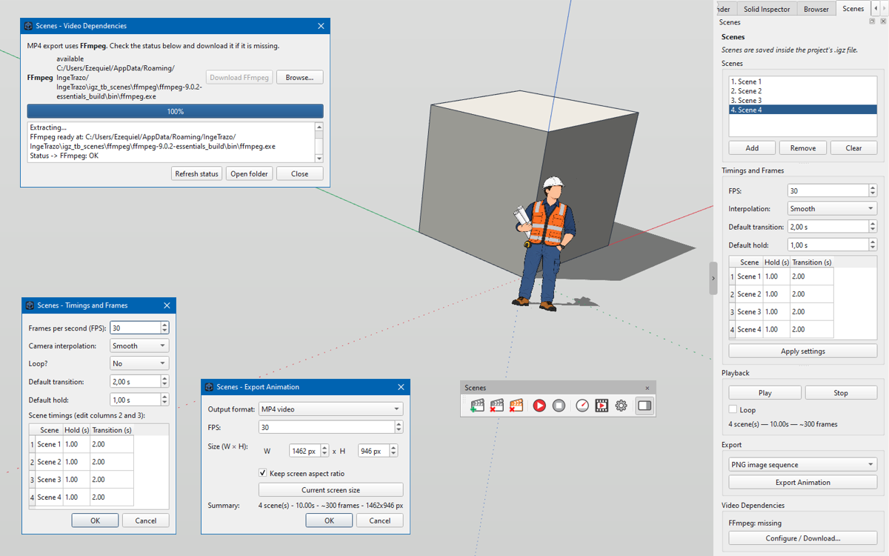

# IngeTrazo Extension — "Scenes" (Scene Manager)

A **toolbar** and a **side panel** for [IngeTrazo](https://github.com/ingelibre/ingetrazo)
that turn camera positions into an ordered list of **scenes** (camera
keyframes), play them back as a smooth camera **animation**, and **export**
the result as a PNG image sequence or an MP4 video.

- **Author:** Ezequiel M. Rezende
- **Date:** 2026-10-14
- **Version:** 1.1.0 (Refactored)
- **License:** [GPL-3.0-or-later](https://www.gnu.org/licenses/gpl-3.0.html)
  (same as IngeTrazo — see [LICENSE](https://github.com/ingelibre/ingetrazo/blob/main/LICENSE))

---



*The **Scenes** toolbar and the **Cenas** side panel.*

---

## Files

The extension is now organized as a Python package for better maintainability:

```text
<plugins>/
└── igz_tb_scenes/
    ├── __init__.py            # Entry point and i18n logic
    ├── README.md              # This file
    ├── README_ptBR.md         # Portuguese version
    ├── LICENSE                # Full GPL-3.0 text
    ├── THIRD-PARTY.md         # Third-party notices
    ├── i18n/                  # Translation files
    │   ├── en.json            # (Empty, source is English)
    │   ├── pt-BR.json
    │   ├── es.json
    │   ├── de.json
    │   ├── fr.json
    │   ├── it.json
    │   └── zh.json
    ├── icons/                 # SVG Icons (dark and _light variants)
    │   ├── scene_add.svg      / scene_add_light.svg
    │   ├── scene_remove.svg   / scene_remove_light.svg
    │   ├── ...
    │   └── scene_panel.svg    / scene_panel_light.svg
    └── core/                  # Modular source code
        ├── __init__.py
        ├── config.py          # QSettings, JSON persistence
        ├── dialog_helpers.py  # Combo box filling, normalization
        ├── dialogs.py         # Dependency, Config, and Export dialogs
        ├── ffmpeg.py          # FFmpeg downloader and renderer
        ├── math_utils.py      # Smoothstep, Catmull-Rom interpolation
        ├── model.py           # Scene data structure, timeline math
        ├── panel.py           # Side panel UI (QWidget)
        ├── controller.py      # Business logic (connects Model & UI)
        └── toolbar.py         # Toolbar creation and panel attachment
```

---

## The "Scenes" Toolbar

Each button captures or plays back camera keyframes. A keyframe stores the
camera **eye** (position), **target** and **fov** (field of view); the panel
adds the per-scene **hold** (how long it stays) and **transition** (how long
it takes to move to the next one).

| Button                         | Icon               |
|--------------------------------|--------------------|
| **Add Current Scene**          | `scene_add`        |
| **Remove Selected Scene**      | `scene_remove`     |
| **Clear Scenes**               | `scene_remove_all` |
| **Play Scene Animation**       | `scene_play`       |
| **Stop Animation**             | `scene_stop`       |
| **Configure Timings & Frames** | `scene_configure`  |
| **Export Animation**           | `scene_export`     |
| **Video Dependencies***        | `scene_ffmpeg`     |
| **Scenes Panel** (toggle)      | `scene_panel`      |

\* The **Video Dependencies** button only appears when FFmpeg cannot be
found; with FFmpeg present, the MP4 export already works.

The toolbar is added to the **top** toolbar area (`igz_tb_scenes`), and the
icons follow the light/dark UI palette (each icon has a `_light` variant).

---

## The "Scenes" Side Panel

The panel is registered using the **host's official API** (`app.add_panel`),
which ensures it appears correctly in the IngeTrazo "Window ▸ Panels" menu.

- **Scenes** — the list (fixed at 5 visible rows) plus **Add**,
  **Remove** and **Clear**.
- **Playback** — **Play**, **Stop**, a **Loop** checkbox and
  a live duration / frame-count label.
- **Timings and Frames** — FPS, interpolation, default transition, default
  hold, a per-scene table (fixed at 4 visible rows) and **Apply settings**.
- **Export** — format (PNG sequence / MP4) and **Export Animation**.
- **Video Dependencies** — the FFmpeg status and a **Configure / Download...** button.

### "Scenes Panel" Button (3-State Logic)

The toolbar button uses a smart 3-state toggle:
1. **Hidden**: Clicking shows the panel and brings it to the front.
2. **Visible but behind other tabs**: Clicking brings it to the front (it does not hide it).
3. **Visible and in front**: Clicking hides it.

The panel uses draggable splitters to adjust the height of the lists.
The icon on the panel's tab is set using `app._set_panel_icon`.

---

## Scenes, the `.igz` file and preferences

- **Scenes belong to the project.** They are saved **inside** the `.igz`
  document (`app.set_document_data`), so they travel with the file and
  participate in undo/redo. Opening or creating a document reloads them.
- **Preferences** — FPS, interpolation, loop, default transition/hold and
  export size — are stored in `config.json` under the app data folder
  (`.../igz_tb_scenes/config.json`), so new projects start with your usual
  values.

---

## Camera Interpolation

Three modes are offered under **Interpolation**:

- **Smooth** — smoothstep (ease in/out).
- **Linear** — constant speed.
- **Catmull-Rom** — a spline through the keyframes, for organically curving
  camera paths.

---

## Export

**Export Animation** asks for format, FPS and **output size** (with a
"keep screen aspect" lock and a "current screen size" reset), then renders
each frame by grabbing the framebuffer:

- **PNG Image Sequence** — writes `scene_00000.png`, … to a folder.
  No external dependency.
- **MP4 Video** — renders PNG frames to a temp folder and muxes them with
  **FFmpeg** (`libx264`, `yuv420p`, even dimensions). Needs FFmpeg; the
  plugin finds it in the saved path, on the `PATH`, in its local data
  folder, or in common locations, and can **download** a build on request
  (**Configure / Download...**).

FFmpeg is optional and **not bundled** — see [THIRD-PARTY.md](THIRD-PARTY.md).

---

## Relationship with `igz_tb_camera`

This is an **independent** extension: it does **not** modify `igz_tb_camera`
(`OrbitPickerTool`, `ZAxisOverlay`, orbits/helix, Z adjustment all stay
there). It only reuses the *pattern* of capturing `eye`/`target`/`fov` and
grabbing frames. Both can be installed at the same time.

---

## Compatibility

- **IngeTrazo 0.5.7+** (using the `app.add_panel` API).
- **PySide6 / Qt 6** — the plugin is pure Python; it uses the in-app
  viewport camera and the grabbable framebuffer.
- Windows-first (the FFmpeg download points at Windows builds), but the
  toolbar, panel and PNG export are cross-platform.

### Language & internationalization

The extension is **fully internationalized**. The UI strings are written in
English in the source code and translated on-the-fly using JSON files in the
`i18n/` folder. It automatically matches the language set in IngeTrazo
(PT-BR, EN, ES, DE, FR, IT, ZH).

---

## Installation

### Manual (scripts / development)

1. In IngeTrazo, run **Extensions ▸ Open plugins folder** (or open the
   per-user plugins folder: `%APPDATA%\IngeTrazo\plugins\` on Windows,
   `~/.local/share/ingetrazo/plugins/` on Linux).
2. Create a folder named **`igz_tb_scenes`** inside it.
3. Copy the **entire contents** of this extension (the `core/`, `i18n/`, and
   `icons/` folders, plus `__init__.py`) into it.
4. Restart IngeTrazo. The **Scenes** toolbar appears in the top area and the
   **Scenes** panel joins the side panels.

> The folder **must** contain the `__init__.py` and the `core/` folder. A
> missing entry point silently produces **no** toolbar and **no** panel.

### From the IngeTrazo extension catalog

Packaged for the community catalog at <https://ingetrazo.com/extensiones>
(repository <https://github.com/ingelibre/ingetrazo-extensions>), which
installs a single `.zip` holding one folder with an `__init__.py`. Build
that archive with `packaging/build_extension.ps1` (Windows) or
`packaging/build_extension.py` (any platform); it lands in
`dist/igz_tb_scenes.zip`. See [`PUBLISHING.md`](PUBLISHING.md).

---

## Usage

1. Move/rotate the camera to the view you want and click **Add Current Scene**.
   Repeat for every view.
2. Open the **Scenes** panel to fine-tune each scene's **Hold** and
   **Transition**, choose the **FPS** and the **Interpolation**, and click
   **Apply settings**.
3. Click **Play** to preview; **Stop** interrupts. Enable **Loop** for a
   looping preview.
4. Click **Export Animation**, choose **PNG** or **MP4**, set the size and
   confirm.
5. Everything is saved with the `.igz`; reopen the file and the scenes come
   back.

---

## Future improvements (optional)

None of these are required — the extension works as-is.

1. **In-viewport timeline** — a scrubber and "add current" shortcut.
2. **Per-scene easing** — a curve selector per keyframe.
3. **`Tool` subclass** — a "Scenes…" entry in the **Extensions** menu with a
   shortcut, so the user can reopen the toolbar if it is closed.

---

## License

GPL-3.0-or-later — the same license as IngeTrazo.
Third-party notices are recorded in [THIRD-PARTY.md](THIRD-PARTY.md).

See <https://www.gnu.org/licenses/gpl-3.0.html>.

Copyright (C) 2026 Ezequiel M. Rezende.

This program is free software: you can redistribute it and/or modify it
under the terms of the GNU General Public License, version 3 or later,
as published by the Free Software Foundation.

This program is distributed in the hope that it will be useful, but
**without any warranty**; without even the implied warranty of
**merchantability** or **fitness for a particular purpose**. See the
GNU General Public License for more details.
```
