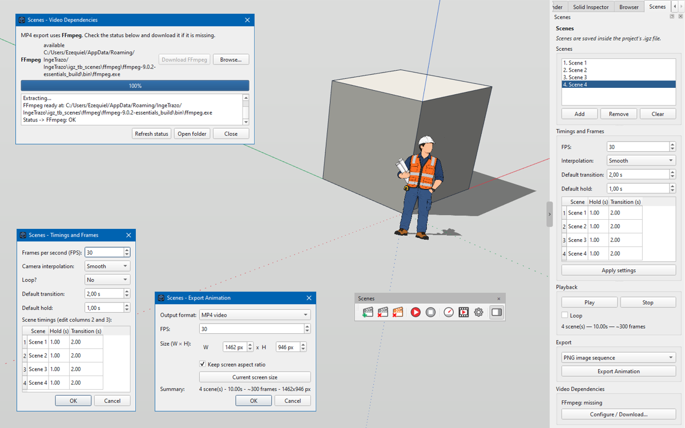

# Extensão IngeTrazo — "Scenes" (Gerenciador de Cenas)

Uma **barra de ferramentas** e um **painel lateral** para o
[IngeTrazo](https://github.com/ingelibre/ingetrazo) que transformam posições
de câmera em uma lista ordenada de **cenas** (keyframes de câmera), as
reproduzem como uma **animação** suave de câmera e **exportam** o resultado
como sequência de imagens PNG ou vídeo MP4.

- **Autor:** Ezequiel M. Rezende
- **Data:** 2026-10-14
- **Versão:** 1.1.0 (Refatorada)
- **Licença:** [GPL-3.0-or-later](https://www.gnu.org/licenses/gpl-3.0.html)
  (mesma do IngeTrazo — ver [LICENSE](https://github.com/ingelibre/ingetrazo/blob/main/LICENSE))

---



*A barra **Scenes** e o painel lateral **Cenas**.*

---

## Arquivos

A extensão agora está organizada como um pacote Python para facilitar a manutenção:

```text
<plugins>/
└── igz_tb_scenes/
    ├── __init__.py            # Ponto de entrada e lógica de i18n
    ├── README.md              # Arquivo em inglês
    ├── README_ptBR.md         # Este arquivo em português
    ├── LICENSE                # Texto completo da GPL-3.0
    ├── THIRD-PARTY.md         # Avisos de terceiros
    ├── i18n/                  # Arquivos de tradução
    │   ├── en.json            # (Vazio, a fonte é o inglês)
    │   ├── pt-BR.json
    │   ├── es.json
    │   ├── de.json
    │   ├── fr.json
    │   ├── it.json
    │   └── zh.json
    ├── icons/                 # Ícones SVG (variantes dark e _light)
    │   ├── scene_add.svg      / scene_add_light.svg
    │   ├── scene_remove.svg   / scene_remove_light.svg
    │   ├── ...
    │   └── scene_panel.svg    / scene_panel_light.svg
    └── core/                  # Código-fonte modular
        ├── __init__.py
        ├── config.py          # Persistência JSON, QSettings
        ├── dialog_helpers.py  # Auxiliares para combos e normalização
        ├── dialogs.py         # Diálogos de Dependências, Config e Exportação
        ├── ffmpeg.py          # Download e renderização via FFmpeg
        ├── math_utils.py      # Smoothstep, interpolação Catmull-Rom
        ├── model.py           # Estrutura da Cena, matemática da timeline
        ├── panel.py           # Interface do painel lateral (QWidget)
        ├── controller.py      # Lógica de negócios (conecta Model e UI)
        └── toolbar.py         # Criação da toolbar e anexo do painel
```

---

## A barra "Scenes"

Cada botão captura ou reproduz keyframes de câmera. Um keyframe guarda
**eye** (posição), **target** (alvo) e **fov** (campo de visão); o painel
acrescenta a **permanência** (quanto tempo fica) e a **transição** (quanto
tempo leva para mover-se até a próxima) por cena.

| Botão                          | Ícone              |
|--------------------------------|--------------------|
| **Adicionar Cena Atual**       | `scene_add`        |
| **Remover Cena Selecionada**   | `scene_remove`     |
| **Limpar Cenas**               | `scene_remove_all` |
| **Tocar Animação de Cenas**    | `scene_play`       |
| **Parar Animação**             | `scene_stop`       |
| **Configurar Tempos e Quadros**| `scene_configure`  |
| **Exportar Animação**          | `scene_export`     |
| **Dependências de Vídeo***     | `scene_ffmpeg`     |
| **Painel de Cenas** (toggle)   | `scene_panel`      |

\* O botão **Dependências de Vídeo** só aparece quando o FFmpeg não é
encontrado; com o FFmpeg presente a exportação MP4 já funciona.

A barra é adicionada à área **superior** (`igz_tb_scenes`), e os ícones
seguem a paleta clara/escura da interface (cada ícone tem uma variante
`_light`).

---

## O painel lateral "Cenas"

O painel é registrado usando a **API oficial do hospedeiro**
(`app.add_panel`), o que garante que ele apareça corretamente no menu
"Janela ▸ Painéis" do IngeTrazo.

- **Cenas** — a lista (fixada em 5 linhas visíveis) mais **Adicionar**,
  **Remover** e **Limpar**.
- **Reprodução** — **Tocar**, **Parar**, a caixa **Repetir em loop** e um
  rótulo dinâmico de duração / número de quadros.
- **Tempos e Quadros** — FPS, interpolação, transição padrão, permanência
  padrão, uma tabela por cena (fixada em 4 linhas visíveis) e **Aplicar
  configuração**.
- **Exportação** — formato (Sequência PNG / MP4) e **Exportar Animação**.
- **Dependências de Vídeo** — o estado do FFmpeg e um botão **Configurar /
  Baixar…**.

### O botão "Painel de Cenas" (Lógica de 3 Estados)

O botão da barra de ferramentas usa um toggle inteligente de 3 estados:
1. **Escondido**: Clicar mostra o painel e o traz para frente.
2. **Visível, mas atrás de outras abas**: Clicar traz o painel para frente (não o esconde).
3. **Visível e na frente**: Clicar esconde o painel.

O painel usa divisores arrastáveis para ajustar a altura das listas.
O ícone na aba do painel é definido usando `app._set_panel_icon`.

---

## Cenas, o arquivo `.igz` e preferências

- **As cenas pertencem ao projeto.** São salvas **dentro** do documento
  `.igz` (`app.set_document_data`), então viajam com o arquivo e participam
  do desfazer/refazer. Abrir ou criar um documento recarrega-as.
- **Preferências** — FPS, interpolação, loop, transição/permanência padrão e
  tamanho de exportação — ficam em `config.json`, na pasta de dados do
  aplicativo (`.../igz_tb_scenes/config.json`), então projetos novos já
  começam com seus valores habituais.

---

## Interpolação da câmera

Há três modos em **Interpolação**:

- **Suave** — smoothstep (acelera/desacelera).
- **Linear** — velocidade constante.
- **Catmull-Rom** — uma spline pelos keyframes, para trajetórias de câmera
  curvas e orgânicas.

---

## Exportação

**Exportar Animação** pergunta o formato, o FPS e o **tamanho de saída**
(com trava de "manter proporção da tela" e um botão "tamanho da tela
atual"), depois renderiza cada quadro capturando o framebuffer:

- **Sequência de Imagens PNG** — grava `scene_00000.png`, … em uma pasta.
  Sem dependência externa.
- **Vídeo MP4** — renderiza os quadros PNG em uma pasta temporária e os
  junta com o **FFmpeg** (`libx264`, `yuv420p`, dimensões pares). Precisa do
  FFmpeg; o plugin o procura no caminho salvo, no `PATH`, na pasta local de
  dados e em locais comuns, e pode **baixar** uma compilação a pedido
  (**Configurar / Baixar…**).

O FFmpeg é opcional e **não é incluído** — veja
[THIRD-PARTY.md](THIRD-PARTY.md).

---

## Relação com o `igz_tb_camera`

Esta é uma extensão **independente**: **não** modifica o `igz_tb_camera`
(`OrbitPickerTool`, `ZAxisOverlay`, órbitas/helix e ajuste de Z continuam lá).
Ela apenas reaproveita o *padrão* de capturar `eye`/`target`/`fov` e de
capturar quadros. As duas podem ser instaladas ao mesmo tempo.

---

## Compatibilidade

- **IngeTrazo 0.5.7+** (usando a API `app.add_panel`).
- **PySide6 / Qt 6** — o plugin é Python puro; usa a câmera da viewport do
  aplicativo e o framebuffer capturável.
- Windows em primeiro lugar (o download do FFmpeg aponta para builds do
  Windows), mas a barra, o painel e a exportação PNG são multiplataforma.

### Idioma & internacionalização

A extensão está **totalmente internacionalizada**. As strings da interface
são escritas em inglês no código-fonte e traduzidas em tempo de execução
usando arquivos JSON na pasta `i18n/`. Ela corresponde automaticamente ao
idioma configurado no IngeTrazo (PT-BR, EN, ES, DE, FR, IT, ZH).

---

## Instalação

### Manual (scripts / desenvolvimento)

1. No IngeTrazo, use **Extensões ▸ Abrir pasta de plugins** (ou abra a pasta
   de plugins do usuário: `%APPDATA%\IngeTrazo\plugins\` no Windows,
   `~/.local/share/ingetrazo/plugins/` no Linux).
2. Crie uma pasta chamada **`igz_tb_scenes`** dentro dela.
3. Copie o **conteúdo completo** desta extensão (as pastas `core/`, `i18n/`,
   `icons/` e o arquivo `__init__.py`) para dentro dela.
4. Reinicie o IngeTrazo. A barra **Scenes** aparece na área superior e o
   painel **Cenas** entra nos painéis laterais.

> A pasta **precisa** conter o `__init__.py` e a pasta `core/`. Um ponto de
> entrada ausente produz, silenciosamente, **nenhuma** barra e **nenhum**
> painel.

### Pelo catálogo de extensões do IngeTrazo

Empacotada para o catálogo da comunidade em
<https://ingetrazo.com/extensiones> (repositório
<https://github.com/ingelibre/ingetrazo-extensions>), que instala um único
`.zip` contendo uma pasta com um `__init__.py`. Gere esse arquivo com
`packaging/build_extension.ps1` (Windows) ou
`packaging/build_extension.py` (qualquer plataforma); ele sai em
`dist/igz_tb_scenes.zip`. Veja [`PUBLISHING.md`](PUBLISHING.md).

---

## Uso

1. Posicione a câmera na vista desejada e clique em **Adicionar Cena Atual**.
   Repita para cada vista.
2. Abra o painel **Cenas** para ajustar a **Permanência** e a **Transição** de
   cada cena, escolha o **FPS** e a **Interpolação** e clique em **Aplicar
   configuração**.
3. Clique em **Tocar** para visualizar; **Parar** interrompe. Marque
   **Repetir em loop** para uma pré-visualização em laço.
4. Clique em **Exportar Animação**, escolha **PNG** ou **MP4**, defina o
   tamanho e confirme.
5. Tudo é salvo junto com o `.igz`; reabra o arquivo e as cenas voltam.

---

## Melhorias futuras (opcional)

Nenhuma destas é necessária — a extensão funciona como está.

1. **Linha do tempo na viewport** — um scrubber e um atalho "adicionar
   atual".
2. **Suavização por cena** — um seletor de curva por keyframe.
3. **Subclasse `Tool`** — uma entrada "Cenas…" no menu **Extensions** com
   atalho, para o usuário reabrir a barra se ela for fechada.

---

## Licença

GPL-3.0-or-later — a mesma licença do IngeTrazo.
Avisos de terceiros ficam em [THIRD-PARTY.md](THIRD-PARTY.md).

Ver <https://www.gnu.org/licenses/gpl-3.0.html>.

Copyright (C) 2026 Ezequiel M. Rezende.

Este programa é software livre: você pode redistribuí-lo e/ou modificá-lo
sob os termos da GNU General Public License, versão 3 ou posterior,
conforme publicada pela Free Software Foundation.

Este programa é distribuído na esperança de ser útil, mas **sem qualquer
garantia**; sem mesmo a garantia implícita de **comercialização** ou
**adequação a um propósito específico**. Veja a GNU General Public License
para mais detalhes.
```